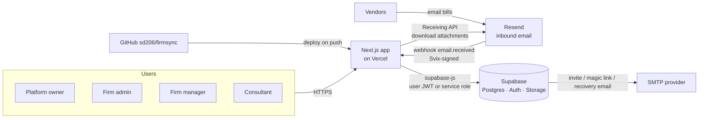
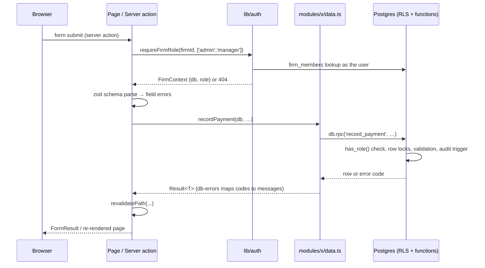
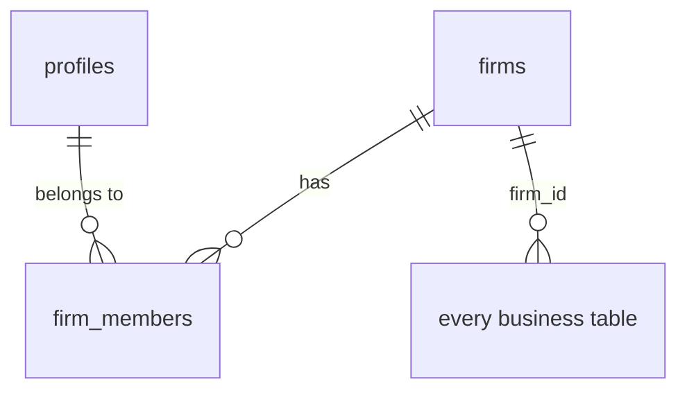
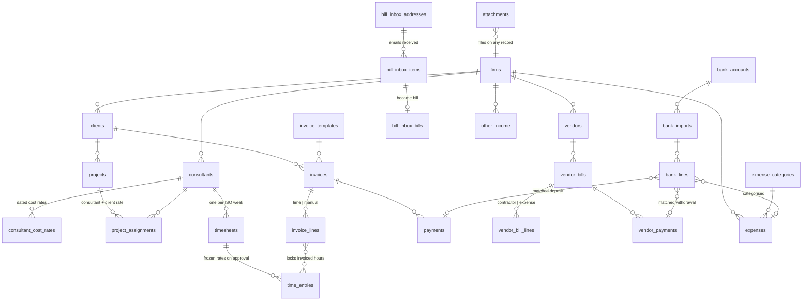
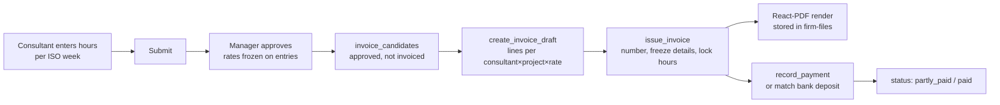
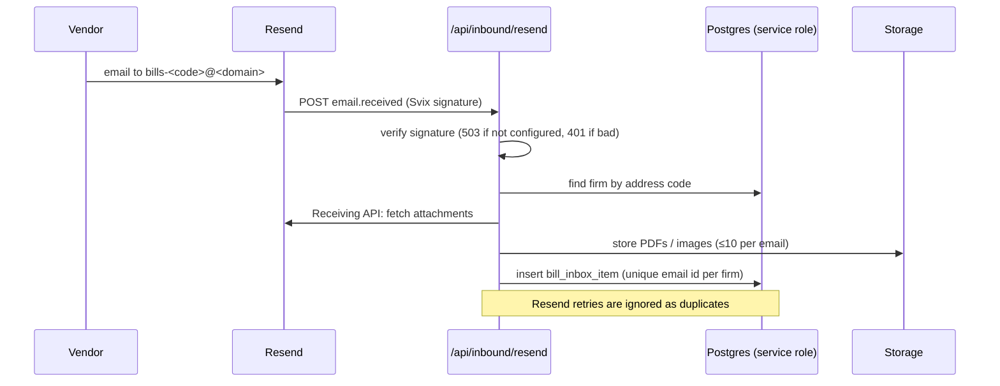

# VeriTreo — Architecture

VeriTreo (formerly FirmSync) is a multi-tenant web app that lets consulting firms run their operations in one place: timesheets, invoices, client payments, vendor bills, expenses, bank statements and reports. This document explains how the system is built and why. The [README](../README.md) covers setup and the detailed business rules for each feature.

Last reviewed: 2026-11-18 (database migrations up to `20261118000049`).

---

## 1. System context



| Piece | What it does |
|---|---|
| **Next.js 15 app** (App Router, React 19, TypeScript) | Pages, server actions, the PDF builder, the CSV routes and the inbound-email webhook. Hosted on Vercel, currently at `firmsync.vercel.app` (the app moves to `app.veritreo.com`; see `docs/superpowers/specs/2026-11-18-custom-domain-design.md`). |
| **Supabase Postgres** | Holds all data and most business rules: row-level security for tenant isolation, plus about 140 database functions (mostly `security definer`) for every multi-step change (issuing an invoice, approving a timesheet, recording a payment and so on). |
| **Supabase Auth** | Email and password, magic links and invites. Public sign-up is disabled, so users only join by invitation. |
| **Supabase Storage** | One private bucket, `firm-files` (10 MB per file), for logos, invoice PDFs, payment and expense files, vendor-bill files and bill-inbox attachments. |
| **Resend** | Receives email sent to each firm's bill-inbox address and posts it to the app; sends invoice emails and storage warnings (`src/lib/email/send.ts`; local Mailpit in development and e2e). |

Production uses the Supabase project `consult-flow`. Local development runs the whole Supabase stack in Docker (ports moved up by 100, so 54421 to 54424).

---

## 2. Guiding principles

1. **The database enforces the rules.** Tenant isolation, roles, status changes and money checks live in Postgres (row-level security, constraints, triggers and `security definer` functions). The app validates input so users get friendly messages, but it never relies on itself alone to keep data correct. A bug in a page can't move another firm's data or overpay an invoice.
2. **Every request runs as the signed-in user.** Server code uses a Supabase client that carries the user's session cookie, so row-level security applies. The service-role (admin) client is used only where no user exists or a step must go beyond one user's rights. Section 6 lists those places.
3. **Money is exact.** Amounts are `numeric(12,2)` in Postgres and come back to TypeScript as strings. Sums are done in whole cents (`src/lib/domain/money.ts`), never in floating point.
4. **Nothing is hard to undo silently.** Rates are frozen at approval, invoice numbers never rewind, issued invoices lock their hours, and an audit trigger records who changed what.
5. **Boring, well-supported tools.** One web framework, one database platform, no queue, no separate API server, no client-side state library.

---

## 3. Code layout

```
src/
  middleware.ts            Session refresh and login redirect for every request
  app/                     Routes (App Router)
    login/, auth/          Sign-in, email-link confirm, set password, OAuth-style callback
    platform/firms/        Platform owner: create firms and their first admin
    f/[firmId]/            Everything inside a firm (layout.tsx builds the role-based menu)
      timesheet(s)/  invoices/  payments/  vendor-bills/  bill-inbox/  expenses/
      other-income/  bank/  reports/{pnl,transactions,receivables,payables}/
      clients/  projects/  consultants/  vendors/  users/  settings/  attachments/
    api/inbound/resend/    Webhook for emailed bills (the only API route)
  modules/<feature>/       Feature logic, one folder per area
    data.ts                Database reads and writes (mostly .rpc() calls), returns Result<T>
    actions.ts             'use server' actions: auth check → zod validation → data.ts → revalidatePath
    schemas.ts             zod input schemas
    *-csv.ts, view-model.ts, parse.ts …  Pure helpers, unit-tested
  lib/
    auth/                  requireUser, requireFirmRole, invites, post-login routing
    supabase/              server, browser, admin (service role) clients; generated types.ts
    domain/                Pure rules: money, dates, ISO weeks, ageing, rates, invoice numbers, file checks
    result.ts, form.ts, db-errors.ts   Result type, form helpers, mapping Postgres errors to messages
  components/ui/           shadcn-style components (Base UI + Tailwind 4)
supabase/
  migrations/              49 ordered SQL migrations: the schema and server-side logic
  templates/               Auth email templates (must also be set on the hosted project)
  seed.sql                 Local platform owner only
scripts/                   Demo-data seeders (local)
tests/
  integration/             Vitest against the local database: RLS, functions, permissions
  e2e/                     Playwright browser tests
```

### Request pattern

Each feature follows the same layered path:



- **Pages** are React Server Components. They call `requireFirmRole` and then `data.ts` readers directly. Client components handle only interactive parts (forms, multi-selects, file uploads).
- **Hiding a page and denying it look the same.** A non-member, or a member without the right role, gets a 404. The page never says the firm or record exists.
- **Errors** come back as `Result<T>` (`{ok, data} | {ok:false, error}`). Expected failures are never thrown.

---

## 4. Tenancy, roles and security

### Tenant model



- Every business table has a `firm_id`. Row-level security policies call helper functions such as `is_member(firm)` and `has_role(firm, roles[])`. These are `security definer` functions with `search_path=''`, so they can read `firm_members` without recursion and can't be hijacked through the search path.
- Composite unique keys of the form `(firm_id, id)` let foreign keys guarantee that child rows (invoice lines, payments, project assignments) belong to the **same firm** as their parent.
- `anon` has no grants at all; the first migration revokes the default privileges.
- A last-admin guard stops a firm from losing its final admin.

### Roles

| Role | Can do |
|---|---|
| **Platform owner** (`profiles.is_platform_owner`) | Create firms and invite each firm's first admin. Doesn't see firm data unless also a member. |
| **Admin** | Everything in the firm, including consultants (cost rates), users, the bill-inbox address and invoice templates. |
| **Manager** | Clients, projects, timesheet approval, invoices, payments, vendor bills, expenses, bank, reports and settings. |
| **Consultant** | Their own timesheet and projects only. Never sees rates, invoices, money or reports. |

Roles are checked twice: in the app (`requireFirmRole`, which also builds the menu) and in the database (row-level security plus `has_role` inside every function, which raises `42501`). Integration tests check that consultants are refused and that one firm can't read another firm's IDs.

### Authentication

- `middleware.ts` refreshes the Supabase session on every request (`getUser()` validates the token with the auth server) and sends unauthenticated users to `/login`. The public paths are `/login`, `/auth/*` and `/api/inbound/*`; the webhook checks its own signature instead.
- Invite, magic-link and recovery emails link to `/auth/confirm` with a token hash, so the session is never placed in the URL fragment. Passwords must be at least 10 characters.

### Audit

The generic trigger `audit_row()` writes before and after JSON, the actor and the action to `audit_log` for audited tables. Only admins can read the log, and nobody can write to it directly.

---

## 5. Domain model



### Status lifecycles

| Entity | Statuses |
|---|---|
| Timesheet | `draft → submitted → approved` or `rejected` (back to draft). An approved timesheet can be reopened while none of its hours are invoiced. |
| Invoice | `draft → issued → partly_paid → paid`, or `void` (issued and unpaid only). Status follows payments automatically. |
| Vendor bill | `pending_approval → approved → partly_paid → paid`, or `rejected` / `void`. |
| Bank line | `new → done` (matched or categorised) or `ignored` (including duplicates). |
| Bill inbox item | received → bill created, ignored, or marked duplicate. Never turned into a bill automatically. |

---

## 6. Key flows

### 6.1 Time → invoice → cash



- **Issuing** runs in a single database function with row locks. It takes the next number from the firm's pattern (`{YYYY}`, `{SEQ:n}` …; the sequence never rewinds), copies the firm and client details onto the invoice, and locks the time entries.
- **The PDF is made after issuing, outside the transaction.** If it fails, the invoice stays issued and "Regenerate PDF" retries. The PDF is built with `@react-pdf/renderer` on the Node runtime; `next.config.ts` ships pdfkit's font files with every route.

### 6.1a Emailing an invoice

1. `invoice_email_start` (security definer) checks the role, that the invoice is issued, partly paid or paid with a stored PDF, the addresses, and the rate limits (same invoice not within 60 s, 10 a day; 50 per firm an hour, 200 a day; serialised per firm with an advisory lock), then writes an `invoice_emails` row as `sending`.
2. The server action reads the stored PDF and sends it through `src/lib/email/send.ts` (Resend, with the row id as the idempotency key), from `"<firm> via <PRODUCT_NAME>" <INVOICE_EMAIL_FROM>` with Reply-To the firm's contact email.
3. `invoice_email_finish` marks the row `sent` or `failed`. A row left `sending` for over 10 minutes shows as "Unknown".

`invoice_emails` is the history (audited, readable by admins and managers, no direct writes). The firm's default wording is `firms.invoice_email_subject` / `invoice_email_body` (null = built-in default). Sending doesn't change the invoice status and stores no files.

### 6.2 Vendor bills and the bill inbox



A manager then chooses **Create bill**, **Ignore** or **Mark duplicate**. A bill goes through approval (`approve_vendor_bill`) before it can be paid (`record_vendor_payment`).

### 6.3 Bank statements

1. Upload OFX, QFX or CSV (up to 4 MB and 5,000 lines). CSV needs a column mapping, which is saved per account (`save_csv_mapping`).
2. The file is parsed in the server action (`modules/bank/parse.ts`). Lines are cleaned and de-duplicated, then inserted by `import_bank_lines`.
3. The review list (`list_bank_lines`) suggests matches. Deposits are matched to invoices (`bank_match_candidates`, `link_bank_line`), withdrawals to vendor payments, and the rest are categorised in bulk as expenses or other income. Lines can be ignored, marked duplicate or reset.

### 6.4 File uploads

Payment, expense and bill files never pass through a server action:

1. The server creates signed upload URLs under a holding name (`incoming-*`).
2. The browser uploads directly to Storage, which avoids Vercel's 4.5 MB request limit.
3. The server checks each file's content (PDF, PNG, JPEG or HEIC, by magic bytes, up to 10 MB), moves good files into place and removes rejected ones.
4. Storage policies only allow users to add files under holding names. Abandoned uploads older than 24 hours are swept the next time that folder is used.

Downloads use short-lived signed URLs.

### 6.5 Storage limits

- **Allowance** per firm: `storage_included_bytes` (5 GiB) + 10 GiB × `storage_blocks` + 1 GiB × `storage_grant_gb`, all on `firms` and changeable only by the service role or the platform owner's `platform_set_storage_grant`.
- **Usage** is summed from `storage.objects` sizes under `firms/<firmId>/` (`firm_storage_status`, `firm_storage_breakdown`, `firm_storage_files`), so every stored file counts, whichever feature wrote it.
- **Gate:** `ensureRoomFor` runs before upload links are issued (attachments) and before a logo is stored. It is a soft check and fails open if the lookup errors. Invoice PDFs and Bill-inbox mail are never gated.
- **Alerts:** after anything is stored, `afterStore` calls `storage_alert_check`, a latch that returns true once per crossing of 95% (re-arming below 90%), and emails the admins through Resend when `NOTIFY_FROM` is set.
- **Clean-up:** Setup › Storage lists files; admins delete attachments through the same `delete_attachment` rules as on each record.

### 6.6 Reports

Reports are read-only database functions that take `p_today` from the app (`todayIso()`), so results are consistent and testable.

| Report | Function(s) | Notes |
|---|---|---|
| Profit & loss | `pnl`, breakdown | Grouped by month, quarter, client or project; up to a 3-year range. |
| Transactions | transactions report | Lists money in and out. |
| Receivables | `receivables_report`, `receivables_invoices` | Ageing buckets, oldest overdue, average days to pay and days late (last 365 days). |
| Payables | `payables_report`, `payables_bills` | Due within 7 days, 8–30 days and later, plus overdue buckets. Bills awaiting approval are shown separately. |

Every report has a CSV download from a `csv/route.ts` beside its page. The CSVs have a UTF-8 BOM and CRLF line endings for Excel, plain-number amounts, and protection against spreadsheet formula injection.

### 6.7 Where the service-role client is used

| Place | Why |
|---|---|
| `modules/storage/alerts` | Reads usage and admins' emails for the 95% warning email after a file is stored. |
| `api/inbound/resend` and `modules/bill-inbox` | Webhook requests have no user, and the signed request is the authority. |
| `modules/firms`, `modules/members`, `modules/consultants` | Inviting users and creating auth accounts need Supabase's admin auth API. |
| `modules/attachments/storage`, `modules/invoices/pdf/storage` | Moving and validating files and writing PDFs. Each call first checks that the user may act on the parent record. |

---

## 7. Deployment and environments

| | Local | Production |
|---|---|---|
| App | `npm run dev` on :3000 | Vercel, built from GitHub `sd206/firmsync` (main) |
| Database | Supabase CLI in Docker (`npx supabase start`) | Supabase project `consult-flow` |
| Migrations | `npm run db:reset` / `npx supabase migration up` | `npx supabase db push --linked` (dry run first, applied deliberately) |
| Email | Mailpit (:54424) | Custom SMTP for auth; Resend for the inbound bill inbox |

**Environment variables:** `NEXT_PUBLIC_SUPABASE_URL`, `NEXT_PUBLIC_SUPABASE_ANON_KEY`, `SUPABASE_SERVICE_ROLE_KEY` (server only), `NEXT_PUBLIC_SITE_URL`, for the bill inbox `RESEND_API_KEY`, `RESEND_INBOUND_SECRET` and `INBOUND_DOMAINS`, optionally `NOTIFY_FROM` for storage warning emails, and `INVOICE_EMAIL_FROM` (falls back to the address in `NOTIFY_FROM`) for emailing invoices; locally `EMAIL_TRANSPORT=mailpit` sends all app email to Mailpit. Without a from address, Email invoice is shown disabled. Without the bill-inbox variables, that feature switches itself off: the webhook answers 503 and Settings says the inbox isn't set up.

**Release order:** apply the database migration before deploying code that depends on it. Migrations use `create or replace` for functions, and changes only add to the schema, so the running app keeps working while the migration is applied.

---

## 8. Testing

| Layer | Tool | Covers |
|---|---|---|
| Unit (`npm run test:unit`) | Vitest | Pure domain rules: money, weeks, ageing, invoice numbering, parsers, CSV builders, view models. |
| Integration (`npm run test:int`) | Vitest against the local Supabase | Row-level security, every database function, role refusals, cross-firm isolation, status changes and edge cases. |
| End-to-end (`npm run test:e2e`) | Playwright | Main user journeys in a real browser, including downloads and 404s for the wrong role. |

Also run `npm run lint` and `npm run typecheck`. After a schema change, `npm run db:types` regenerates `src/lib/supabase/types.ts`.

---

## 9. Known limits and future work

- **No background jobs.** PDF generation and file checks run inline in the request; a failed PDF is retried by the user. A queue would only be needed for heavier work, such as reading bill PDFs automatically.
- **Single currency per firm**, with tax as one percentage per invoice.
- **"Today" is UTC**, which matters for week boundaries and ageing near midnight.
- **Report queries** run on demand against the live tables. This is fine at current firm sizes; the payment-history step in Receivables scans all of a firm's payments and could need an index or summary table at large volumes.
- **Possible next reports:** profitability by consultant, and late or missing timesheets.
- **Bill inbox** uses Resend's `*.resend.app` domain today; moving to a custom domain is a configuration change (see the README).
